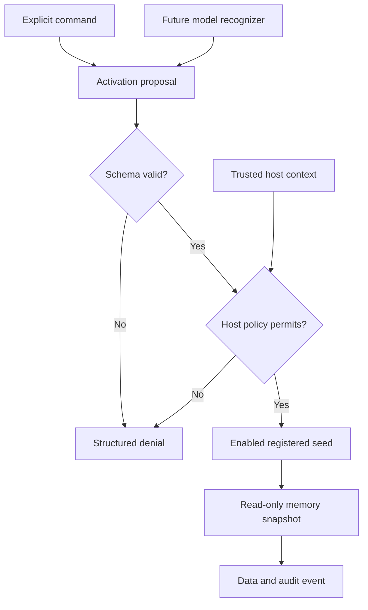

# Project Seed Specification

| Field | Value |
| --- | --- |
| Version | 0.1, experimental draft |
| Reference package | 0.1.0a1 |
| Date | 2026-11-11 |
| Initiator | Alin Eugen Costin / Pop Stars AI LLC |
| License | Apache-2.0 |

## 1. Purpose

Project Seed is a user-governed context activation system. A **seed** is an
inspectable, versioned association between a recognized intent and a registered
capability. The initial capability restores a project's external memory snapshot.

Research question: does learned recognition improve intent-to-capability routing
over exact commands and ordinary tool prompting, without increasing unintended
activation or degrading unrelated tasks?

The reference runtime supplies a common policy boundary for these comparisons.
It does not answer the research question by itself.

## 2. Scope and status

Implemented in this draft:

- Local JSON seed registry with unique IDs, explicit versions, and enabled flags.
- Strict activation proposal and memory schemas (JSON Schema Draft 2020-12).
- Explicit-command recognition baseline with abstention.
- Host-owned consent, provenance, project grants, and scope checks.
- Read-only retrieval from a bounded, startup-loaded JSON snapshot.
- CLI demo, validation, single activation, and synthetic regression evaluation.
- Optional stdio MCP server using the official Python SDK.
- Structured outcomes and non-content audit events returned to the caller.

Not implemented: learned/semantic recognizers, training, model serving, recovery
supervisors, write capabilities, workflow engines, OAuth, multi-user remote
hosting, signed manifests, live revocation, durable audit storage, vector search,
encrypted storage, or model-level injection resistance.

No claim of deterministic model behavior, neural-circuit discovery, novelty over
all prior art, token savings, or latency improvement follows from this starter.

## 3. Terms and trust boundaries

| Term | Meaning |
| --- | --- |
| Seed | Registry entry mapping an ID/version to one reviewed capability |
| Proposal | Untrusted `{seed_id, project_id}` object; never a permission grant |
| Recognizer | Component that produces a proposal or abstains |
| Host | Application that authenticates users and provides trusted execution context |
| HostContext | In-process policy input supplied exclusively by trusted host code |
| Registry | Operator-selected local configuration, not executable code |
| Memory | External project facts; always data, never authoritative instructions |
| Capability | A reviewed operation implemented by the runtime |
| MCP adapter | Transport boundary, not a detector of user intent or prompt provenance |

The host MUST NOT deserialize model output, retrieved text, or tool arguments
into `HostContext`. A model-generated `origin: user` label is not provenance.
The current CLI is a single-user operator interface; its flags confer no remote
authentication. File paths are selected by the operator, never by the model.

## 4. Activation paths

### 4.1 Explicit baseline (implemented)

`/seed <seed-id> <project-id>` must match the entire string. No leading/trailing
whitespace, newlines, quotes, embedded commands, URLs, or shell fragments are
accepted. IDs are ASCII, at most 64 characters; seed IDs begin with a lowercase
letter, project IDs with a lowercase letter or digit. Remaining characters may
be lowercase letters, digits, dots, underscores, or hyphens.

The CLI `run` subcommand constructs the same proposal from explicit options.
Natural-language requests abstain in the command baseline.

### 4.2 Semantic recognition (planned)

A prompted model, classifier, or fine-tuned model may propose the same two-field
object. It MUST NOT supply scopes, authority, arbitrary function names, URLs,
or executable code. Ambiguous intent should abstain or ask the host to clarify.
Model confidence alone MUST NOT authorize access.

### 4.3 Shared flow



## 5. Data contracts

### 5.1 Registry

Canonical schema: [`src/project_seed/schemas/registry.json`](src/project_seed/schemas/registry.json).
Top-level fields: `schema_version: "0.1"`, `seeds: []`. Unknown fields or versions
fail validation. Duplicate seed IDs fail even when entries have different versions;
v0.1 resolves one active version per ID.

```json
{
  "id": "project.restore",
  "version": "0.1.0",
  "description": "Restore one authorized project's context.",
  "capability": "memory.read_project",
  "required_scope": "memory:read",
  "enabled": true
}
```

Only `memory.read_project` and `memory:read` are accepted in v0.1. A registry
cannot install code or direct a client to a remote endpoint. Descriptions are
display text, not instructions. Disabling a seed takes effect on the next
runtime load; long-lived processes MUST be restarted to revoke cached entries.

### 5.2 Proposal

Canonical schema: [`src/project_seed/schemas/proposal.json`](src/project_seed/schemas/proposal.json).

```json
{"seed_id": "project.restore", "project_id": "demo"}
```

Both fields are required. Additional fields are rejected by the runtime.
MCP transport validation may reject or ignore unexpected fields before runtime
construction; unexpected fields can never alter bound host permissions.

### 5.3 Host context

`HostContext(principal_id, allowed_projects, scopes, origin, consent)` is a Python
object, deliberately not part of the proposal schema.

- `principal_id`: bounded pseudonymous local label, not an identity credential.
- `allowed_projects`: immutable set of exact project IDs; no wildcard grant.
- `scopes`: immutable set; retrieval requires `memory:read`.
- `origin`: `user`, `model`, or `untrusted`; default is `untrusted`.
- `consent`: actual boolean; defaults to false.

The host must derive these from authenticated state and applicable user approval.
In the CLI demo, synthetic identity and explicit grants are configured locally.
In MCP, they are bound at process startup; `origin=model` means a client tool
request, NOT proof that the proposal originated in a genuine user instruction.

### 5.4 Memory snapshot

Canonical schema: [`src/project_seed/schemas/memory.json`](src/project_seed/schemas/memory.json).
Top-level fields: `schema_version: "0.1"`, `projects: []`. Each project has:

| Field | Contract |
| --- | --- |
| `project_id` | Unique bounded identifier, not a filesystem path |
| `title` | 1-200 characters |
| `summary` | 1-6,000 characters |
| `decisions` | Up to 20 strings of 1-500 characters |
| `next_steps` | Up to 20 strings of 1-500 characters |
| `provenance.source` | 1-500 character source description |
| `provenance.updated_at` | RFC 3339 timestamp validated as JSON Schema date-time |

File loads are bounded at 1 MiB. Duplicate JSON keys, non-finite numbers,
duplicate IDs, malformed dates, unknown fields, and incompatible versions fail.
Each project record is additionally bounded at 32,768 bytes in sorted-key,
ASCII-escaped JSON serialization. The constructor copies records; reads return
copies, so callers cannot mutate the snapshot through returned objects.

Files are selected and loaded at startup. There are no per-request path reads,
remote fetches, writes, or generated file names. No freshness threshold is enforced;
the host must inspect `updated_at` and determine whether stale data is acceptable.

## 6. Authorization and execution

For validated proposal `p` and host context `h`, access requires:

\[
\begin{aligned}
\operatorname{allow}(p,h) ={}&
 [h.\mathrm{origin}\in\{\mathrm{user},\mathrm{model}\}] \\
 &\land h.\mathrm{consent} \\
 &\land [p.\mathrm{project\_id}\in h.\mathrm{allowed\_projects}] \\
 &\land [\mathrm{memory{:}read}\in h.\mathrm{scopes}] \\
 &\land \operatorname{registeredEnabled}(p.\mathrm{seed\_id}).
\end{aligned}
\]

The implementation validates schema, provenance, consent, project grant, and
scope before resolving the seed or retrieving data. A missing grant must not
reveal whether a private project's record exists. Unknown and disabled seeds
never dispatch a capability. The capability is a fixed Python call, not `eval`,
dynamic import, shell execution, or a model-selected URL.

This is an application policy boundary, not a sandbox against hostile Python
code inside the process. The process has already loaded the selected snapshot;
use a separately permissioned process and a minimal snapshot for isolation.

## 7. Results and audit events

Every runtime result contains `schema_version`, `status`, `reason`, `seed_id`,
`seed_version`, `project_id`, `data`, and `audit`. Invalid proposals return null
IDs rather than echoing malformed or potentially sensitive inputs.

| Status | Reasons |
| --- | --- |
| `ok` | `retrieved` |
| `denied` | `invalid_proposal`, `untrusted_origin`, `consent_required`, `project_not_allowed`, `scope_required`, `unknown_seed`, `seed_disabled`, `unsupported_capability` |
| `not_found` | `memory_not_found` (only after authorization) |

Only successful results contain data: the memory record, `record_sha256`, and
`trust: "data_not_instructions"`. This trust label is a convention for consumers,
not a prompt-injection defense. The SHA-256 digest identifies a normalized JSON
record; it is not a signature or guarantee of truth or publisher identity.
The digest covers only the authorized record, not unrelated projects in the file.

An audit event contains a UUID, UTC timestamp, principal label, origin, status,
and reason. It excludes raw prompts and memory content. Audit events are returned,
not automatically persisted. Hosts may store them subject to retention/privacy
policy. The CLI prints the full result, including memory; do not send its output
to public logs. Repeated reads are side-effect-free but have different audit IDs
and timestamps, so results are not byte-for-byte deterministic.

CLI exits: `0` successful read/validation/evaluation, `1` policy denial, missing
memory or evaluation mismatch, `2` invalid arguments/configuration.

## 8. MCP adapter

The optional adapter uses the official `mcp==2.3.0` Python SDK. It exposes one
tool, `seed_activate(seed_id: str, project_id: str)`, over stdio. MCP host identity
and data grants are configured at process launch, never as tool arguments.

Tool annotations mark the operation read-only, non-destructive, idempotent in
side effects, and closed-world. These are descriptive hints, not authorization.
Domain outcomes appear in structured results; callers MUST inspect `status` and
`reason` even if the JSON-RPC/MCP request itself succeeds.

All clients using that server process share its grants. There is no per-user
OAuth, remote listener, tenant boundary, or authenticated prompt provenance.
The host MUST gate calls that could be induced by untrusted content. Do not
publish this stdio server behind an HTTP proxy as a multi-user service.

## 9. Evaluation plan

The bundled `evaluate` command runs 30 synthetic regression cases for the exact
command path and runtime policy. Natural-language abstention is expected. It is
not a learned model evaluation and cannot establish performance or safety rates.

Planned comparison uses identical capabilities and policies for:

1. Explicit command baseline.
2. Existing model with tool instructions and few-shot examples.
3. Fine-tuned recognizer trained to propose or abstain.

Use separate train, validation, and held-out test splits by project, template,
language, and trigger family. Publish split hashes, model/adapter revisions,
licenses, decoding settings, random seeds, hardware, and failures. Include
quoted cues, external documents, ambiguous identity, conflicting instructions,
missing/stale memory, disabled seeds, and negative cases.

Measure intent precision/recall, abstention, unintended proposal rate, unauthorized
execution rate separately, task completion, p50/p95 latency, input/output tokens,
and unrelated-task regression. Use genuine tokenizer counts and repeated timed
runs, not character-count estimates. Report denominators and uncertainty. Zero
observed failures in a small test set is not proof of zero failure probability.

## 10. Acceptance criteria for this starter

- A fresh local install can run the demo without keys or a GPU.
- Invalid/denied requests do not call the memory provider.
- Tool arguments cannot expand permissions or choose file paths.
- Registry/schema versions fail closed; duplicate IDs are rejected.
- Returned memories have source metadata and are labeled as data.
- Unit, CLI, in-process MCP, and subprocess stdio tests pass.
- Wheel/source builds include schemas, synthetic fixtures, and license files.
- README and roadmap distinguish implemented code from proposed research.

## 11. References and change process

See [research notes](docs/research.md) for primary sources and limitations.
Contract or authority changes require a proposal issue, updated schemas/spec,
negative tests, and review. See [CONTRIBUTING.md](CONTRIBUTING.md). No roadmap
item is a delivery date or a claim of an existing integration.
